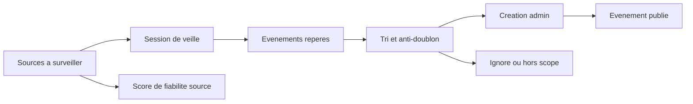

# Système professionnel de collecte et suivi des événements

## Objectif

Mettre en place un système de travail qui permet d’ajouter les événements dans l’admin sans naviguer au hasard entre sites, comptes Instagram, événements Facebook, newsletters et agendas partenaires.

Le but est de savoir à tout moment:

- quelles sources sont à surveiller;
- quand elles ont été vérifiées pour la dernière fois;
- quels événements ont été trouvés;
- quels événements sont déjà créés, ignorés ou à vérifier;
- quelles sources sont fiables, lentes, redondantes ou prioritaires;
- quoi faire chaque jour sans perdre de temps.

Ce document décrit un process opérationnel complet, utilisable d’abord dans un tableur ou Notion, puis intégrable dans l’admin OutLive.

---

## Principe général

Le problème n’est pas seulement “ajouter des événements”. Le vrai problème est de transformer une veille dispersée en pipeline clair.

Le système doit séparer trois choses:

1. **Les sources**: les endroits à surveiller.
2. **Les opportunités**: les événements repérés mais pas encore traités.
3. **Les événements admin**: les événements réellement créés, publiés ou rejetés.

---

## 1. Registre des sources

Créer une base unique “Sources événements”. Chaque ligne représente une source à surveiller.

### Champs indispensables

| Champ | Description | Exemple |
| --- | --- | --- |
| Nom | Nom public de la source | Le 108, Astrolabe, Supersoniks |
| Type | Nature de la source | Instagram, Facebook, site web, newsletter, billetterie |
| URL principale | Lien direct à ouvrir | `https://...` |
| Ville / zone | Zone couverte | Orléans, Tours, Paris |
| Catégorie dominante | Type d’événements | Concert, club, expo, théâtre |
| Priorité | Importance éditoriale | P0, P1, P2, P3 |
| Fréquence de scan | Rythme idéal | Quotidien, 2x/semaine, hebdo, mensuel |
| Dernier scan | Date du dernier contrôle | 2026-04-27 |
| Prochain scan | Date calculée ou manuelle | 2026-04-29 |
| Statut source | État actuel | Active, pause, morte, doublon |
| Fiabilité | Qualité de la source | Très fiable, moyenne, faible |
| Taux de nouveauté | Fréquence à laquelle elle donne de vrais nouveaux événements | Fort, moyen, faible |
| Temps moyen | Temps pour vérifier la source | 1 min, 5 min, 15 min |
| Notes | Particularités | “Poste souvent les events en story uniquement” |

### Priorités recommandées

| Priorité | Définition | Fréquence |
| --- | --- | --- |
| P0 | Source essentielle, gros volume ou événements très importants | Tous les jours |
| P1 | Source fiable et régulière | 2 à 3 fois par semaine |
| P2 | Source utile mais moins fréquente | 1 fois par semaine |
| P3 | Source occasionnelle ou secondaire | 1 à 2 fois par mois |

### Règle importante

Une source qui ne produit rien pendant 6 à 8 semaines doit être déclassée ou mise en pause. Le système doit éviter de faire perdre du temps à surveiller des sources mortes.

---

## 2. Pipeline des opportunités

Chaque événement repéré doit passer par une file de traitement avant d’être créé dans l’admin.

### Statuts recommandés

| Statut | Signification | Action suivante |
| --- | --- | --- |
| À scanner | Source à ouvrir pendant la session | Vérifier la source |
| Repéré | Événement trouvé mais pas encore analysé | Contrôler doublon et données |
| À compléter | Données manquantes | Chercher lieu, date, prix, image |
| Prêt à créer | Toutes les données sont suffisantes | Créer dans l’admin |
| Créé | Événement ajouté dans l’admin | Vérifier publication |
| Publié | Visible côté app | Fin du traitement |
| Doublon | Déjà existant | Lier à l’événement existant |
| Hors scope | Pas pertinent pour OutLive | Archiver avec raison |
| À rechecker | Trop incertain ou pas encore annoncé officiellement | Revenir plus tard |

### Champs d’une opportunité événement

| Champ | Description |
| --- | --- |
| Titre brut | Nom tel qu’il apparaît sur la source |
| Source | Source d’origine |
| URL source | Lien vers le post, event Facebook, page billetterie ou agenda |
| Date détectée | Date de l’événement |
| Lieu détecté | Lieu ou ville |
| Catégorie pressentie | Concert, DJ set, expo, marché, etc. |
| Données manquantes | Date, horaire, prix, image, lieu, description |
| Score confiance | Faible, moyen, fort |
| Doublon potentiel | Lien vers événement existant si doute |
| Propriétaire | Personne qui traite, même si tu es seul au début |
| Deadline traitement | Date limite avant laquelle l’ajouter |
| Décision | Créer, ignorer, rechecker |

---

## 3. Tableau de bord quotidien

L’admin doit idéalement avoir une page “Collecte” qui donne une vision immédiate du travail.

### Blocs du dashboard

1. **Sources à scanner aujourd’hui**
   - Liste triée par priorité.
   - Bouton “Ouvrir source”.
   - Bouton “Marquer scannée”.
   - Bouton “Événement trouvé”.

2. **Événements repérés à traiter**
   - Tous les événements au statut `Repéré`, `À compléter`, `À rechecker`.
   - Tri par date d’événement la plus proche.
   - Indicateur “risque de retard”.

3. **Prêts à créer**
   - Les événements qui ont assez de données pour être créés rapidement.
   - Objectif: vider cette liste en premier.

4. **Sources en retard**
   - Sources dont le prochain scan est dépassé.
   - Permet de ne pas oublier Instagram ou Facebook pendant plusieurs jours.

5. **Qualité de couverture**
   - Nombre de sources scannées cette semaine.
   - Nombre d’événements créés.
   - Nombre de sources sans nouveautés.
   - Nombre de doublons détectés.

---

## 4. Process quotidien ultra productif

Durée cible: 25 à 45 minutes.

### Étape 1: ouvrir la file prioritaire

Commencer par les sources P0 et P1 dues aujourd’hui. Ne pas ouvrir les sources au hasard.

Ordre de traitement:

1. Sources P0 en retard.
2. Sources P0 du jour.
3. Sources P1 en retard.
4. Opportunités déjà prêtes à créer.
5. Sources P2 seulement s’il reste du temps.

### Étape 2: scanner une source avec un timer

Chaque source doit avoir un temps maximum.

| Source | Temps maximum |
| --- | --- |
| Instagram simple | 1 à 2 minutes |
| Agenda site web clair | 2 à 4 minutes |
| Facebook events | 3 à 5 minutes |
| Site complexe / billetterie | 5 à 8 minutes |

Si une source dépasse son temps maximum, créer une opportunité `À rechecker` ou `À compléter`, puis passer à la suite.

### Étape 3: capturer immédiatement les événements

Quand un événement est trouvé, ne pas le créer tout de suite si cela casse le rythme de veille. D’abord le capturer rapidement:

- titre;
- date;
- lien source;
- lieu;
- capture ou image si disponible;
- note rapide sur ce qui manque.

Ensuite seulement, pendant une phase dédiée, créer les événements dans l’admin.

### Étape 4: traiter les événements prêts

Une fois la veille terminée, passer en mode production:

1. Prendre les événements `Prêt à créer`.
2. Vérifier le doublon.
3. Créer l’événement dans l’admin.
4. Publier ou laisser en brouillon selon la confiance.
5. Marquer l’opportunité comme `Créé` ou `Publié`.

### Étape 5: clôturer la session

À la fin:

- marquer les sources scannées;
- mettre à jour `prochain scan`;
- archiver les hors scope;
- garder seulement les vrais sujets à traiter dans la file active.

---

## 5. Process hebdomadaire

Durée cible: 45 à 60 minutes, une fois par semaine.

### Revue de couverture

Questions à se poser:

- Quelles sources ont produit le plus d’événements utiles?
- Quelles sources ont consommé du temps sans résultat?
- Quels lieux ou organisateurs importants n’ont pas été vus cette semaine?
- Y a-t-il des événements importants découverts trop tard?
- Y a-t-il trop de doublons?

### Actions hebdomadaires

- Déclasser les sources peu utiles.
- Ajouter les nouvelles sources découvertes.
- Augmenter la fréquence des sources qui produisent beaucoup.
- Réduire la fréquence des sources faibles.
- Identifier les lieux ou organisateurs manquants.
- Préparer une shortlist des événements importants de la semaine suivante.

---

## 6. Règles anti-doublons

Avant de créer un événement, vérifier:

1. Même titre ou titre proche.
2. Même date.
3. Même lieu.
4. Même organisateur.
5. Même lien de billetterie ou post source.

### Score de doublon conseillé

| Condition | Points |
| --- | --- |
| Même date | +30 |
| Même lieu | +25 |
| Titre très proche | +25 |
| Même URL source | +50 |
| Même organisateur | +15 |

Si le score dépasse 60, l’admin doit afficher “doublon probable”.

---

## 7. Score de priorité d’un événement

Tous les événements repérés ne méritent pas le même effort.

### Score recommandé

| Critère | Points |
| --- | --- |
| Événement dans les 7 prochains jours | +30 |
| Source P0 | +25 |
| Lieu important | +20 |
| Artiste ou organisateur connu | +15 |
| Image et infos complètes disponibles | +10 |
| Événement gratuit ou accessible | +5 |
| Données très incomplètes | -20 |
| Hors zone principale | -30 |

Prioriser les événements avec le score le plus haut.

---

## 8. Architecture idéale dans l’admin

### Nouvelle section: “Collecte”

Pages recommandées:

- `Sources`: registre complet des sources.
- `À scanner`: checklist quotidienne.
- `Événements repérés`: pipeline des opportunités.
- `Analyse`: statistiques de couverture.

Dans l'UI opérationnelle, ces vues peuvent être condensées dans un seul écran de session si la hiérarchie reste claire:

- une barre sticky de session pour les chiffres critiques et les actions rapides;
- une file de scan principale dense;
- un panneau latéral ou colonne de capture/pipeline;
- les formulaires secondaires, comme la création de source complète, hors du flux principal visible.

### Actions rapides par source

Chaque source doit proposer:

- ouvrir le lien;
- copier l’URL;
- marquer comme scannée;
- ajouter un événement repéré;
- signaler source morte;
- modifier fréquence;
- ajouter note.

### Actions rapides par opportunité

Chaque opportunité doit proposer:

- créer événement;
- compléter avec IA depuis URL;
- détecter doublon;
- ignorer avec raison;
- reprogrammer le check;
- ouvrir la source.

---

## 9. Modèle de données recommandé

### Table `event_sources`

| Champ | Type |
| --- | --- |
| `id` | uuid |
| `name` | text |
| `type` | text |
| `url` | text |
| `location_id` | uuid |
| `organizer_id` | uuid |
| `organizer_location_id` | uuid |
| `priority` | text |
| `scan_frequency_days` | integer |
| `last_scanned_at` | timestamp |
| `next_scan_at` | timestamp |
| `status` | text |
| `reliability_score` | integer |
| `novelty_score` | integer |
| `average_scan_minutes` | integer |
| `category_hint` | text |
| `city_hint` | text |
| `notes` | text |
| `created_at` | timestamp |
| `updated_at` | timestamp |

Règle métier: une source doit toujours être rattachée à au moins un référent exploitable: `location_id`, `organizer_id` ou `organizer_location_id`. Le lieu principal et l’organisateur restent indépendants pour couvrir les cas “événement dans un lieu X organisé par Y”.

### Table `event_opportunities`

| Champ | Type |
| --- | --- |
| `id` | uuid |
| `source_id` | uuid |
| `source_url` | text |
| `raw_title` | text |
| `detected_date` | timestamp |
| `detected_location` | text |
| `detected_category` | text |
| `missing_fields` | text[] |
| `status` | text |
| `confidence_score` | integer |
| `priority_score` | integer |
| `duplicate_event_id` | uuid |
| `created_event_id` | uuid |
| `decision_reason` | text |
| `notes` | text |
| `created_at` | timestamp |
| `updated_at` | timestamp |

---

## 10. Automatisations utiles

### Court terme

- Calcul automatique du prochain scan.
- Badge “source en retard”.
- Détection de doublons basique.
- Création d’événement depuis une opportunité.
- Pré-remplissage depuis URL.

### Moyen terme

- Import automatique depuis certains agendas publics.
- Extraction IA depuis page web, Facebook ou texte copié.
- Suggestions de catégories et tags.
- Historique de performance des sources.
- Rappel hebdomadaire des sources critiques non scannées.

### Long terme

- Scraping contrôlé des sites fiables.
- Inbox automatique depuis newsletters.
- Extension navigateur “Ajouter à OutLive”.
- Détection automatique des nouveaux posts Instagram/Facebook via outils externes compatibles.
- Score de couverture par ville, lieu et catégorie.

---

## 11. Routine recommandée

### Tous les matins

1. Ouvrir “Sources à scanner aujourd’hui”.
2. Scanner uniquement P0 et P1 dues.
3. Capturer les opportunités sans les traiter en profondeur.
4. Créer les événements `Prêt à créer`.
5. Marquer la session comme terminée.

### Deux fois par semaine

1. Scanner P2.
2. Nettoyer `À rechecker`.
3. Compléter les événements incomplets.

### Une fois par semaine

1. Revue des sources.
2. Ajustement des fréquences.
3. Ajout ou suppression de sources.
4. Vérification de la couverture éditoriale.

---

## 12. MVP recommandé

Pour aller vite, ne pas commencer par une usine à gaz. Le MVP doit répondre à trois questions:

1. Quelles sources dois-je scanner maintenant?
2. Quels événements ai-je déjà repérés?
3. Quels événements sont prêts à être créés?

### MVP en 5 fonctionnalités

1. Table des sources avec priorité, fréquence, dernier scan, prochain scan.
2. Bouton “marquer scannée”.
3. Bouton “événement trouvé” qui crée une opportunité.
4. Kanban des opportunités avec statuts.
5. Action “créer événement depuis opportunité”.

### Ce qu’il ne faut pas faire au début

- Automatiser toutes les sources immédiatement.
- Scraper Instagram ou Facebook en premier.
- Créer trop de statuts.
- Mélanger veille, création et analytics dans un seul écran.
- Tout traiter en temps réel pendant la veille.

---

## 13. Indicateurs de performance

À suivre chaque semaine:

| Indicateur | Objectif |
| --- | --- |
| Sources scannées / sources dues | > 90% |
| Événements repérés | Mesurer volume brut |
| Événements créés | Mesurer production réelle |
| Doublons évités | Mesurer qualité |
| Événements découverts trop tard | Tendre vers 0 |
| Temps moyen par événement créé | Réduire progressivement |
| Sources sans nouveauté depuis 8 semaines | À nettoyer |

---

## 14. Organisation mentale du travail

Le process doit éviter trois pièges:

1. **Naviguer sans liste**: toujours partir d’une file de sources dues.
2. **Créer pendant qu’on cherche**: séparer la veille et la production.
3. **Tout garder en tête**: chaque événement repéré doit devenir une opportunité traçable.

La bonne logique est:

- scanner vite;
- capturer léger;
- trier proprement;
- créer en batch;
- mesurer chaque semaine.

---

## Conclusion

Le système idéal pour OutLive est un “Event Intake Operating System”: une chaîne claire entre sources, opportunités et événements publiés.

La priorité n’est pas d’automatiser tout de suite, mais de créer une discipline de suivi très fiable. Une fois cette base en place, l’automatisation devient beaucoup plus simple, car on sait exactement quelles sources valent le coup, lesquelles font perdre du temps, et où se situent les vrais blocages.
