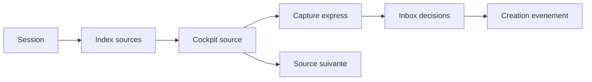

# Plan de refonte Collecte

## Objectif

Transformer la page `Collecte` en véritable poste de travail source-first: rapide, lisible, minimal et suffisamment guidé pour enchaîner une session de veille sans se perdre.

L’admin doit toujours répondre à trois questions:

1. Quelle source dois-je traiter maintenant ?
2. Qu’ai-je trouvé et comment je le capture ?
3. Quelles opportunités dois-je décider ou créer ?

---

## Diagnostic UX

La page Collecte est devenue fonctionnelle, mais plusieurs zones peuvent encore entrer en concurrence:

- le header de session peut répéter des actions déjà disponibles dans le cockpit source;
- la file de scan peut devenir trop actionnelle alors qu’elle devrait surtout servir à choisir une source;
- la capture peut ressembler à un formulaire classique au lieu d’un compositeur rapide;
- le pipeline peut demander trop de lecture si chaque carte affiche trop d’actions secondaires;
- l’utilisateur doit percevoir immédiatement le flux `Source -> Capture -> Décision`.

La refonte doit donc réduire la charge cognitive, pas seulement réorganiser les cartes.

---

## Principe central

Adopter un modèle `workspace`:

- une session visible en haut;
- une source active au centre du travail;
- une capture express liée à cette source;
- une inbox de décisions claire;
- les actions secondaires dans des menus, jamais au même niveau que l’action principale.



---

## Structure cible

### 1. Header de session

Le header doit rester minimal.

Contenu recommandé:

- état de session: prête ou active;
- source active ou prochaine source;
- sources à scanner;
- sources en retard;
- opportunités prêtes;
- événements trouvés pendant la session;
- progression de session;
- actions globales uniquement: `Commencer/Reprendre`, `Ajouter source`.

À éviter:

- `Ouvrir`, `Capturer`, `Scannée`, `Suivante` dans le header;
- les filtres de sources dans le header;
- les actions liées à une source précise.

Ces actions appartiennent au cockpit source.

---

### 2. Index sources

La file de scan doit devenir un index, pas un espace d’action.

Rôle:

- choisir rapidement une source;
- filtrer et rechercher;
- voir l’état de travail en un coup d’œil.

Contenu recommandé par ligne:

- nom de la source;
- priorité;
- statut de travail;
- date du prochain scan;
- entité liée courte;
- compteur d’événements trouvés;
- état actif très visible.

Interactions:

- clic sur une ligne = charger le cockpit source;
- pas de bouton `Scan`, `Ouvrir`, `Éditer` directement visible sur chaque ligne;
- recherche texte intégrée;
- filtres compacts: `À scanner`, `P0/P1`, `Retard`, `Actives`, `Toutes`;
- scroll interne pour les grosses sessions.

---

### 3. Cockpit source

Le cockpit source est le centre d’action.

Il doit concentrer toutes les actions liées à la source active:

- ouvrir la source;
- capturer une opportunité;
- terminer le scan;
- passer à la source suivante;
- éditer;
- reset scan;
- changer le statut;
- marquer source morte.

Affichage recommandé:

- en-tête compact: nom, priorité, statut, entité liée;
- 3 métriques maximum: prochain scan, scans, trouvés;
- action principale visible;
- actions secondaires dans un menu;
- historique discret des derniers mouvements.

À éviter:

- un cockpit trop vertical;
- trop de texte explicatif;
- plusieurs CTA primaires;
- duplication avec le header.

---

### 4. Capture express

La capture ne doit pas ressembler à un formulaire complet. Elle doit être un compositeur rapide.

Modes:

- `Rien`: titre brut;
- `URL`: URL à analyser;
- `Image`: image ou URL image;
- `Facebook`: URL événement Facebook.

Règles UX:

- si une source est active, ne pas afficher un second select source;
- synchroniser automatiquement la source active;
- afficher un seul champ principal selon le mode;
- garder les détails avancés repliés;
- utiliser un CTA précis:
  - `Ajouter manuel`;
  - `Importer URL`;
  - `Importer image`;
  - `Importer Facebook`.

---

### 5. Inbox de décisions

Le pipeline doit devenir une inbox d’actions, pas une liste brute d’opportunités.

Groupes recommandés:

- `Doublons probables`;
- `Prêts à créer`;
- `À compléter / qualifier`;
- `Autres`.

Chaque carte doit être lisible en une passe:

- statut;
- score;
- mode de capture;
- source;
- titre;
- lieu/date;
- champs manquants;
- action principale unique.

Actions principales:

- doublon probable -> `Doublon`;
- prêt -> `Créer`;
- incomplet -> `Prêt` ou `Éditer`, selon l’état.

Actions secondaires:

- ouvrir source;
- copier lien;
- éditer;
- changer statut;
- archiver;
- hors scope.

Ces actions doivent rester dans un menu secondaire.

---

## Layout recommandé

```text
Session header
--------------------------------------------------
1 Source                | 2 Capture
Cockpit source          | Capture express
Index sources           |
                        | 3 Décision
                        | Inbox opportunités
```

Sur desktop:

- colonne gauche large: cockpit + index sources;
- colonne droite sticky: capture + décisions;
- les décisions doivent rester visibles pendant le travail.

Sur mobile:

- session;
- cockpit;
- capture;
- index;
- inbox;
- sheets pour édition source/opportunité.

---

## Règles de qualité UX

- Une seule action principale visible par zone.
- Une source active doit toujours être évidente.
- La capture doit être faisable en moins de 10 secondes.
- Les actions dangereuses ou secondaires doivent être regroupées.
- Le pipeline doit trier par décision attendue, pas seulement par date.
- Aucun choix de source redondant quand une source active existe.
- Les filtres ne doivent jamais prendre plus d’importance que l’action.

---

## Ordre d’implémentation recommandé

1. Simplifier le header de session.
2. Transformer la file en index dense.
3. Faire du cockpit source l’unique zone d’action source.
4. Convertir la capture en compositeur express.
5. Transformer le pipeline en inbox de décisions.
6. Ajuster le layout global.
7. Valider avec diagnostics et lint ciblé.

---

## Validation

Validation technique recommandée:

- diagnostics sur les composants `intake`;
- lint ciblé sur les fichiers modifiés;
- vérification des props après suppression des actions redondantes;
- aucun test UI navigateur si l’objectif est de rester sur validation statique.

Validation produit recommandée:

- démarrer une session;
- sélectionner une source;
- ouvrir la source;
- capturer une opportunité manuelle;
- capturer via URL;
- marquer la source scannée;
- traiter une opportunité prête;
- archiver une opportunité hors scope.

---

## Prochain durcissement possible

Une fois cette UX stabilisée, les prochains gains forts sont:

- mesurer le temps réel passé par source;
- rattacher les opportunités trouvées à un scan précis;
- améliorer l’anti-doublon avec organisateur et URL;
- générer un résumé de fin de session;
- suggérer automatiquement les sources à prioriser.
